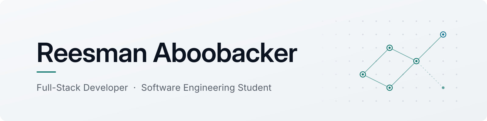

<picture>
  <source media="(prefers-color-scheme: dark)" srcset="assets/readme/banner-dark.png">
  <source media="(prefers-color-scheme: light)" srcset="assets/readme/banner-light.png">
  
</picture>

  Full-stack developer building accessible, user-centered web applications. 
  HNDIT (Software Engineering) · SLIATE, Sri Lanka · <b>GPA 4.00</b>

  <a href="https://portfolioreesman.vercel.app/">Portfolio</a> &nbsp;·&nbsp;
  <a href="https://www.linkedin.com/in/reesman14">LinkedIn</a> &nbsp;·&nbsp;
  <a href="https://medium.com/@reesmank14">Medium</a> &nbsp;·&nbsp;
  <a href="mailto:reesman1429@gmail.com">Email</a>

 

## About

I'm a Software Engineering student at SLIATE, Sri Lanka, pursuing a Higher National Diploma in Information Technology (HNDIT). I build practical web applications that solve real problems — taking an idea from problem definition to a working product: planning the data model, designing the interface, implementing, debugging, and refining it based on how people actually use it.

I'm especially interested in full-stack development, accessible UI/UX, maintainable software design, and AI-assisted development.

## Featured Projects

### [Pesu (பேசு)](https://github.com/reesmanmaf14/pesu-app)

A Tamil–English picture talking board that helps children with speech difficulties express their needs, feelings, and thoughts.

- Builds grammatical Tamil sentences from tapped pictures, with speech in English and Tamil
- Therapist role that approves parent accounts and records Tamil pronunciations
- Accessible by design: 48px touch targets, keyboard and screen-reader support, dark mode, reduced motion

**Stack:** Laravel 12 · PHP · Blade · JavaScript (Web Speech API, MediaRecorder) · Tailwind CSS · Vite · SQLite / PostgreSQL · PHPUnit  
**Links:** [Live demo](https://pesu-app-pink.vercel.app) · [Repository](https://github.com/reesmanmaf14/pesu-app)

### [SpeechCare](https://github.com/reesmanmaf14/SpeechCare)

My final-year project: a speech therapy clinic management system with separate admin, therapist, and parent portals, parent registration, and OTP-verified password recovery.

**Stack:** PHP · MySQL · Bootstrap · PHPMailer  
**Links:** [Repository](https://github.com/reesmanmaf14/SpeechCare)

### [AI Future Lab](https://github.com/reesmanmaf14/ai-future-lab)

An interactive educational website that introduces machine learning, neural networks, computer vision, and generative AI through simulated, hands-on demos.

**Stack:** HTML · CSS · JavaScript  
**Links:** [Live demo](https://ai-future-lab-five.vercel.app/) · [Repository](https://github.com/reesmanmaf14/ai-future-lab)

### [Personal Portfolio](https://github.com/reesmanmaf14/Portfolio-Updated)

A responsive developer portfolio with a component-based design and smooth motion.

**Stack:** React · Vite · Tailwind CSS · GSAP  
**Links:** [Live site](https://portfolioreesman.vercel.app/) · [Repository](https://github.com/reesmanmaf14/Portfolio-Updated)

### Academic & Other Projects

- **[Book-Selling-App](https://github.com/reesmanmaf14/Book-Selling-App)** — C# Windows Forms desktop app with login and sign-up, separate admin and user dashboards, book management, and ordering.

## Tech Stack

**Languages**  

**Frontend**  

**Backend & Data**  

**Web APIs**  

**Tools**  

## Currently Building & Learning

- Building and improving Laravel web applications
- Learning modern frontend development with React and JavaScript
- Exploring AI/ML fundamentals through small, practical beginner projects
- Strengthening software design, debugging, and maintainable architecture
- Designing accessible, user-centered applications

---

  Get in touch: <a href="mailto:reesman1429@gmail.com">reesman1429@gmail.com</a> &nbsp;·&nbsp;
  <a href="https://www.linkedin.com/in/reesman14">LinkedIn</a> &nbsp;·&nbsp;
  <a href="https://portfolioreesman.vercel.app/">Portfolio</a>

